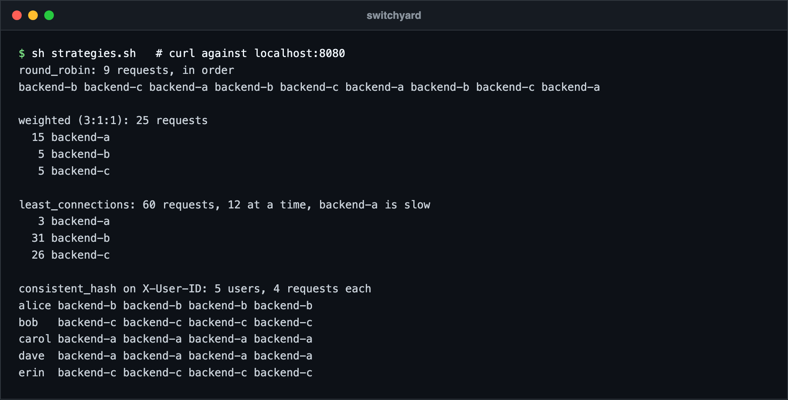
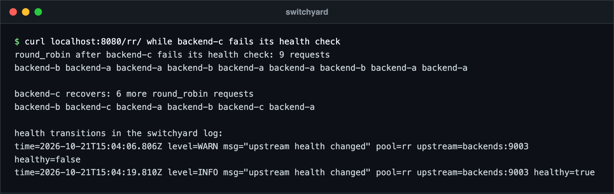
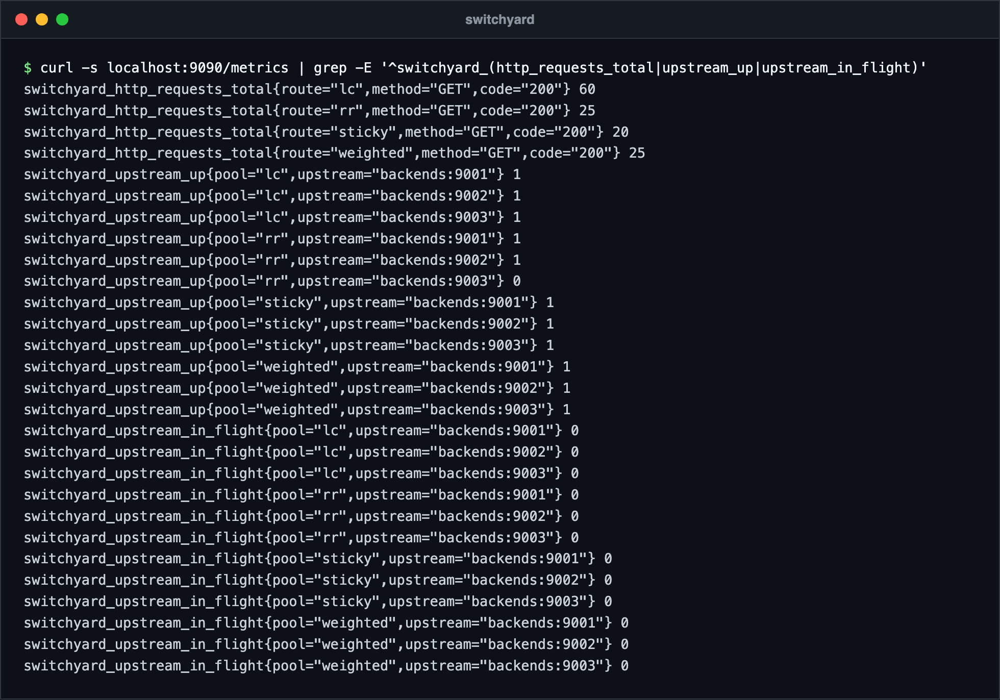
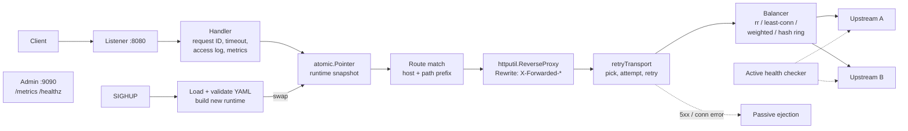

# switchyard

An HTTP reverse proxy and load balancer written in Go, built on the standard
library (`net/http`, `net/http/httputil`, `log/slog`). The only dependency is
a YAML parser.

switchyard routes requests by host and path prefix to pools of upstreams,
balances them with one of four strategies, takes failing upstreams out of
rotation through active and passive health checks, retries idempotent
requests on a different upstream, and reloads its configuration on `SIGHUP`
without closing the listener.

## Screenshots



Real requests through one switchyard instance in front of three small test backends (not production traffic). Round-robin rotates, the 3:1:1 weights give backend-a 15 of 25 requests, least-connections sends little to the deliberately slow backend-a, and consistent hashing keeps each `X-User-ID` on one backend.



backend-c starts failing `/healthz`. After the unhealthy threshold it drops out of the rotation, and it comes back after the healthy threshold once the check passes again. The log shows both transitions.



The admin port's `/metrics` output while backend-c is failing its health check: `switchyard_upstream_up` is 0 for that upstream in the `rr` pool.

## Why

Proxies such as nginx, HAProxy and Envoy are large. switchyard is
small enough to read in an afternoon while still handling the parts that
matter in practice: health state that both probes and live traffic feed,
retries that never repeat a non-idempotent request, a consistent-hash ring
that only remaps the keys of the node that left, and a config swap that a
request in flight never sees half-applied.

## Features

- Routes by host (exact or `*.example.com`) and segment-aware path prefix; most specific route wins
- Strategies: round-robin, least-connections, smooth weighted round-robin, consistent hashing (header or client IP, virtual nodes)
- Active health checks: interval, timeout, healthy and unhealthy thresholds
- Passive ejection after N consecutive 5xx responses or connection errors
- Retries for idempotent methods on another upstream; small bodies are buffered so `PUT` and `DELETE` can be replayed
- Per-route timeouts (504 on expiry), optional prefix stripping and `Host` preservation
- `X-Forwarded-For`, `X-Forwarded-Host`, `X-Forwarded-Proto`; client-supplied values are not trusted
- `X-Request-ID` propagation (a random ID is assigned when missing or malformed) and structured access logs via `log/slog`
- Prometheus text metrics written by hand on a separate admin port: counters, histograms, gauges
- Hot reload on `SIGHUP` through an `atomic.Pointer` swap; graceful shutdown on `SIGINT`/`SIGTERM`

## Architecture



A **runtime** is an immutable snapshot built from one configuration: routes,
pools, balancers, health checkers and an `http.Transport`. Each request loads
the current snapshot once and uses it until it finishes. Reload builds a new
snapshot, carries over the active health verdict of upstreams that exist in
both, swaps the pointer, then stops the old health checkers and closes its
idle connections. Requests already in flight on the old snapshot complete
normally.

The **retry transport** sits under `httputil.ReverseProxy`, so the standard
library still handles hop-by-hop headers, trailers, streaming and protocol
upgrades. For each attempt it asks the balancer for an upstream it has not
tried yet, records the outcome for passive health and metrics, and decides
whether another attempt is allowed.

```
cmd/switchyard        flags, signals, servers, reload
internal/config       YAML schema, defaults, validation
internal/upstream     upstream state: health, ejection, in-flight count
internal/balancer     strategies and the hash ring
internal/health       active probes and threshold tracking
internal/metrics      Prometheus text exposition
internal/proxy        handler, routing, retry transport, runtime snapshots
```

## Quick start

```sh
make build
./bin/switchyard -config examples/switchyard.yaml -check   # validate only
./bin/switchyard -config examples/switchyard.yaml

curl -H 'Host: api.example.com' localhost:8080/v1/users
curl localhost:9090/metrics

kill -HUP  $(pgrep switchyard)   # reload the config
kill -TERM $(pgrep switchyard)   # drain and exit
```

With Docker:

```sh
docker build -t switchyard .
docker run --rm -p 8080:8080 -p 9090:9090 \
  -v "$PWD/my.yaml:/etc/switchyard/switchyard.yaml:ro" switchyard
```

## Configuration

```yaml
listen: ":8080"
admin_listen: ":9090"
shutdown_timeout: 15s
log_format: json            # json | text
max_retry_body: 1048576     # largest request body buffered for replay

pools:
  api:
    strategy: least_connections
    upstreams:
      - url: http://10.0.0.11:9000
      - url: http://10.0.0.12:9000
    health_check:
      path: /healthz
      interval: 5s
      timeout: 1s
      healthy_threshold: 2
      unhealthy_threshold: 3
    passive:
      max_failures: 5        # 0 disables passive ejection
      ejection_time: 30s

  sessions:
    strategy: consistent_hash
    hash_key: header:X-User-ID   # or "ip"; header falls back to client IP
    virtual_nodes: 160
    upstreams:
      - url: http://10.0.1.11:9000
      - url: http://10.0.1.12:9000
        weight: 2                # weight multiplies the virtual nodes

routes:
  - name: api
    host: api.example.com
    path_prefix: /v1
    pool: api
    timeout: 10s
    retries: 2

  - name: sessions
    path_prefix: /session
    pool: sessions
    strip_prefix: true
```

Unknown keys are rejected, and validation reports every problem at once.
Defaults: strategy `round_robin`, weight 1, 100 virtual nodes, passive
ejection after 5 failures for 30s, route timeout 30s, 1 retry. Active health
checks are off unless `health_check` is present.

## Strategies

| Strategy | Picks | State | Best for | Watch out for |
|---|---|---|---|---|
| `round_robin` | Next upstream in order | One atomic counter | Identical, stateless backends | Ignores how busy an upstream is |
| `least_connections` | Fewest in-flight requests, ties rotate | In-flight count per upstream | Requests with uneven duration, slow endpoints | Counts are local to this instance |
| `weighted` | Smooth weighted round-robin | Current weight per upstream, under a mutex | Mixed capacity, gradual traffic shifts | Weights are static until reload |
| `consistent_hash` | First eligible point clockwise on the ring | Sorted ring of virtual nodes | Cache affinity, sticky sessions by user or tenant | Hot keys stay hot; balance depends on virtual node count |

Rule of thumb: start with `round_robin`, move to `least_connections` when
request cost varies, use `weighted` when machines differ, and reserve
`consistent_hash` for when locality is worth more than perfect balance.

## Design decisions

- **Snapshot and swap instead of locks.** The request path reads one
  `atomic.Pointer`; nothing on it waits for a reload. A broken config file is
  rejected and the previous snapshot keeps serving.
- **Health is two signals, one gate.** Active probes set `healthy`; live
  traffic sets an ejection deadline. An upstream receives traffic only when
  both allow it. Thresholds on both sides stop a flapping backend from
  bouncing in and out.
- **Retries are conservative.** Only `GET`, `HEAD`, `OPTIONS`, `TRACE`, `PUT`
  and `DELETE` are retried, only on a connection error or 502/503/504, only
  on an upstream not yet tried for this request, and never after the route
  deadline or a client disconnect. Bodies larger than `max_retry_body` or of
  unknown length are streamed and simply not retried.
- **Ring positions depend on the upstream URL only.** Removing one upstream
  remaps exactly the keys it owned; the tests check that every other key
  stays where it was. Keys of an ejected node spill to its ring neighbour and
  return when it recovers.
- **The proxy is the edge.** Inbound `X-Forwarded-*` headers are dropped and
  rebuilt from the connection, so a client cannot spoof its address.
- **Metrics without a client library.** The exposition format is small;
  writing it by hand keeps the binary dependency-free and makes the output
  exactly testable.
- **Left out on purpose:** TLS termination, HTTP/3, service discovery,
  rate limiting and a dynamic admin API. Each is better handled by a
  dedicated layer or would double the code size.

## Metrics

| Metric | Type | Labels |
|---|---|---|
| `switchyard_http_requests_total` | counter | route, method, code |
| `switchyard_http_request_duration_seconds` | histogram | route |
| `switchyard_upstream_responses_total` | counter | pool, upstream, class |
| `switchyard_retries_total` | counter | route |
| `switchyard_upstream_ejections_total` | counter | pool, upstream |
| `switchyard_config_reloads_total` | counter | result |
| `switchyard_upstream_up` | gauge | pool, upstream |
| `switchyard_upstream_in_flight` | gauge | pool, upstream |

## Running tests

```sh
make test    # go test -race ./...
make lint    # go vet + gofmt check
```

The suite uses `httptest` servers throughout. It covers the distribution of
every strategy, hash-ring stability when a node is removed, health-check
threshold transitions and probe timeouts, passive ejection, retries on
another upstream with body replay, no retry for `POST`, route timeouts,
forwarded headers, reload under concurrent traffic, and the exact metrics
exposition output.

## License

MIT, see [LICENSE](LICENSE).

Author: Ahmed Mahdy
